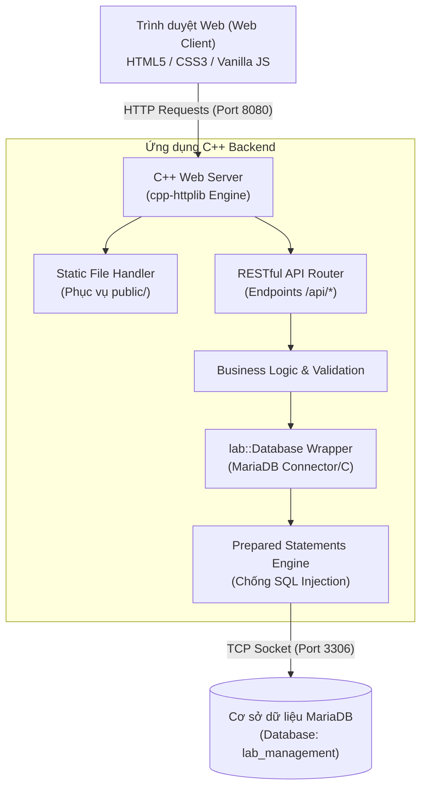

# 🖥️ Lab Management Server — Website Quản Lý Thiết Bị Phòng Máy

[](https://en.cppreference.com/w/cpp/17)
[](https://mariadb.org/)
[](https://github.com/yhirose/cpp-httplib)
[](https://ubuntu.com/)
[](LICENSE)

Hệ thống website nội bộ dành cho các trường học và trung tâm công nghệ nhằm quản lý toàn diện phần cứng phòng máy: máy tính (PC), màn hình, chuột, bàn phím và các thiết bị mạng. Dự án được xây dựng với mục tiêu hiệu năng cao bằng **C++**, lưu trữ dữ liệu bền vững trên **MariaDB**, giao diện web **HTML/CSS/JS** trực quan và quy trình cộng tác nhóm chuyên nghiệp trên **GitHub**.

---

## 🎯 Chức Năng Chính Của Hệ Thống

1. **Hiển thị danh sách thiết bị:** Trình bày đầy đủ thông tin chi tiết về mã quản lý, model, loại linh kiện, phòng máy và tình trạng.
2. **Tìm kiếm & Lọc nâng cao:** Tìm kiếm tức thời theo mã thiết bị, tên gọi hoặc lọc nhanh theo từng phòng máy (`LAB101`, `LAB102`,...) và loại thiết bị.
3. **Quản lý thiết bị (CRUD):** Thêm mới, cập nhật thông tin và xóa thiết bị khỏi hệ thống.
4. **Quản lý tình trạng hoạt động:** Phân loại rõ ràng 3 trạng thái: `Active` (Hoạt động), `Broken` (Hỏng hóc), `Repairing` (Đang sửa chữa).
5. **Ghi nhận sự cố & Lịch sử bảo trì:** Tạo phiếu báo hỏng khi phát hiện sự cố; theo dõi quy trình xử lý qua 3 trạng thái: `Pending` (Chờ xử lý), `InProgress` (Đang xử lý), `Completed` (Đã hoàn thành).
6. **Dashboard thống kê trực quan:** Bảng chỉ số tổng quan (KPI cards) hiển thị tổng số máy, số lượng máy hoạt động, máy lỗi và số phiếu sự cố tồn đọng.
7. **Lưu trữ dữ liệu bền vững:** Dữ liệu lưu trong CSDL quan hệ MariaDB, đảm bảo toàn vẹn dữ liệu với khóa chính, khóa ngoại và chỉ mục tối ưu.
8. **RESTful API chuẩn hóa:** Cung cấp 10 endpoint giao tiếp thông qua JSON với mã trạng thái HTTP chuẩn mực (200, 201, 400, 404, 500).
9. **Dễ dàng triển khai:** Cung cấp sẵn Makefile chuẩn hóa, script kiểm thử tự động và tài liệu hướng dẫn chạy trên môi trường Ubuntu Linux / VirtualBox.

---

## 🏗️ Kiến Trúc Hệ Thống (System Architecture)



---

## 📁 Cấu Trúc Thư Mục Dự Án

```text
lab-management-server/
├── .github/
│   ├── pull_request_template.md    # Mẫu kiểm duyệt Pull Request
│   └── ISSUE_TEMPLATE/
│       └── bug_report.md           # Mẫu báo cáo lỗi hệ thống
├── include/
│   ├── database.h                  # Khai báo lớp Database, models và prepared statements
│   └── httplib.h                   # Thư viện HTTP cpp-httplib (single-header)
├── src/
│   ├── main.cpp                    # Điểm khởi chạy Web Server, routing REST API và CORS
│   └── database.cpp                # Hiện thực kết nối MariaDB và các thao tác CRUD
├── public/
│   ├── index.html                  # Giao diện Dashboard & quản lý thiết bị
│   ├── style.css                   # Giao diện hiện đại, responsive, CSS Variables
│   └── app.js                      # Logic JavaScript phía client, gọi RESTful API
├── sql/
│   └── schema.sql                  # Script tạo CSDL, bảng, chỉ mục và dữ liệu mẫu
├── tests/
│   ├── README.md                   # Hướng dẫn kiểm thử thủ công và tự động
│   └── run_api_tests.sh            # Script bash tự động kiểm thử toàn bộ API qua cURL
├── docs/
│   ├── API_SPECIFICATION.md        # Đặc tả chi tiết 10 RESTful API endpoints
│   ├── DATABASE_DESIGN.md          # Thiết kế ERD, cấu trúc bảng và bảo mật CSDL
│   ├── GITHUB_WORKFLOW.md          # Quy chuẩn làm việc nhóm 4 người trên GitHub
│   └── TEST_PLAN.md                # Kế hoạch và ma trận kiểm thử hệ thống
├── .env.example                    # Mẫu cấu hình biến môi trường (không chứa secret)
├── .gitignore                      # Loại bỏ file build, nhị phân, log và file .env thật
├── Makefile                        # Tự động hóa build, run, clean, kiểm tra thư viện
├── README.md                       # Tài liệu tổng quan dự án (file này)
└── CONTRIBUTING.md                 # Quy tắc đóng góp và phân công vai trò 4 thành viên
```

> **Giải thích điều chỉnh cấu trúc:**
> Thư viện single-header `include/httplib.h` và script kiểm thử `tests/run_api_tests.sh` được tích hợp sẵn để thành viên có thể biên dịch và chạy kiểm thử tự động ngay trên mọi bản phân phối Ubuntu mà không gặp lỗi thiếu thư viện ngoài.

---

## 💻 Yêu Cầu Môi Trường & Cài Đặt (Ubuntu Linux)

Hệ thống được thiết kế để chạy mượt mà trên **Ubuntu Linux** (20.04, 22.04, 24.04 LTS), có thể sử dụng trực tiếp hoặc qua máy ảo **Ubuntu trên VirtualBox**.

### 1. Cài đặt các gói phụ thuộc (Dependencies)
Mở terminal trên Ubuntu và chạy lệnh sau:

```bash
sudo apt update
sudo apt install -y build-essential libmariadb-dev libmariadb3 mariadb-server curl git
```

### 2. Thiết lập Cơ sở dữ liệu MariaDB
Khởi động dịch vụ MariaDB (nếu chưa chạy):
```bash
sudo systemctl enable --now mariadb
```

Nhập cấu trúc bảng và dữ liệu mẫu kiểm thử:
```bash
sudo mariadb < sql/schema.sql
```

Tạo tài khoản ứng dụng an toàn (không dùng `root`):
```sql
sudo mariadb -e "CREATE USER IF NOT EXISTS 'lab_user'@'localhost' IDENTIFIED BY 'lab_password_change_me';"
sudo mariadb -e "CREATE USER IF NOT EXISTS 'lab_user'@'127.0.0.1' IDENTIFIED BY 'lab_password_change_me';"
sudo mariadb -e "GRANT SELECT, INSERT, UPDATE, DELETE ON lab_management.* TO 'lab_user'@'localhost';"
sudo mariadb -e "GRANT SELECT, INSERT, UPDATE, DELETE ON lab_management.* TO 'lab_user'@'127.0.0.1';"
sudo mariadb -e "FLUSH PRIVILEGES;"
```

### 3. Cấu hình Biến môi trường
Sao chép file cấu hình mẫu sang `.env`:
```bash
cp .env.example .env
```
*(Nếu bạn đổi mật khẩu user CSDL, hãy cập nhật tương ứng trong file `.env`)*.

---

## 🔨 Biên Dịch & Chạy Ứng Dụng

### 1. Kiểm tra môi trường biên dịch
```bash
make check-deps
```

### 2. Biên dịch mã nguồn
```bash
make
```
File thực thi sẽ được tạo tại `bin/server`.

### 3. Khởi chạy Web Server
```bash
make run
```
Sau khi khởi chạy thành công, mở trình duyệt trên Ubuntu (hoặc từ máy host nếu cấu hình mạng VirtualBox ở chế độ Bridged/Port Forwarding):
👉 Truy cập: **[http://localhost:8080](http://localhost:8080)**

---

## 🧪 Kiểm Thử Hệ Thống (Testing)

Trong một cửa sổ terminal khác trên Ubuntu:
```bash
# Chạy bộ test suite tự động kiểm thử toàn bộ 10 API
make test
```
Hoặc chạy trực tiếp script:
```bash
./tests/run_api_tests.sh 127.0.0.1 8080
```
Chi tiết về các kịch bản kiểm thử: xem tại [docs/TEST_PLAN.md](docs/TEST_PLAN.md).

---

## 📡 Danh Sách RESTful API

Tất cả phản hồi đều có định dạng `application/json`. Chi tiết tham số và mã lỗi xem tại [docs/API_SPECIFICATION.md](docs/API_SPECIFICATION.md).

| HTTP Method | Endpoint | Mô tả chức năng | HTTP Status |
|---|---|---|---|
| `GET` | `/api/health` | Kiểm tra trạng thái máy chủ & kết nối MariaDB | `200` |
| `GET` | `/api/stats` | Lấy thống kê tổng hợp thiết bị cho Dashboard | `200` |
| `GET` | `/api/devices` | Danh sách thiết bị (hỗ trợ query `search`, `room`, `status`) | `200` |
| `GET` | `/api/devices/:id` | Xem chi tiết 1 thiết bị theo ID | `200`, `404` |
| `POST` | `/api/devices` | Thêm mới thiết bị vào phòng máy | `201`, `400` |
| `PUT` | `/api/devices/:id` | Cập nhật thông tin/trạng thái thiết bị | `200`, `400`, `404` |
| `DELETE` | `/api/devices/:id` | Xóa thiết bị khỏi hệ thống | `200`, `404` |
| `GET` | `/api/maintenance` | Danh sách phiếu sự cố bảo trì (lọc theo `status`) | `200` |
| `POST` | `/api/maintenance` | Ghi nhận sự cố hỏng hóc thiết bị | `201`, `400` |
| `PUT` | `/api/maintenance/:id` | Cập nhật tiến độ xử lý bảo trì (`InProgress`, `Completed`) | `200`, `400` |

---

## 👥 Phân Công Nhóm & Quy Trình GitHub

Nhóm gồm **4 thành viên**, làm việc theo mô hình nhánh tính năng (Feature Branching). Xem chi tiết tại [docs/GITHUB_WORKFLOW.md](docs/GITHUB_WORKFLOW.md) và [CONTRIBUTING.md](CONTRIBUTING.md).

- **`main`**: Nhánh chính được bảo vệ, chỉ chứa code đã kiểm duyệt.
- **`feature/server-api`** (Thành viên 1): C++ Web Server, routing, RESTful API, Makefile.
- **`feature/database`** (Thành viên 2): MariaDB, schema.sql, database.h, database.cpp, CRUD.
- **`feature/frontend`** (Thành viên 3): HTML, CSS, JavaScript, Dashboard UI.
- **`feature/testing-deployment`** (Thành viên 4): Kiểm thử API, test cases, systemd service, deploy guide.

---

## 🔒 Quy Định Bảo Mật & Thông Tin Bản Quyền

- Không commit mật khẩu thật, secrets hoặc file `.env` lên GitHub.
- CSDL chỉ cấp quyền cho user `lab_user`, không dùng quyền root.
- Dự án phát triển cho môn học theo giấy phép mã nguồn mở MIT.
- **Repository Owner:** [tit-coder](https://github.com/tit-coder).
