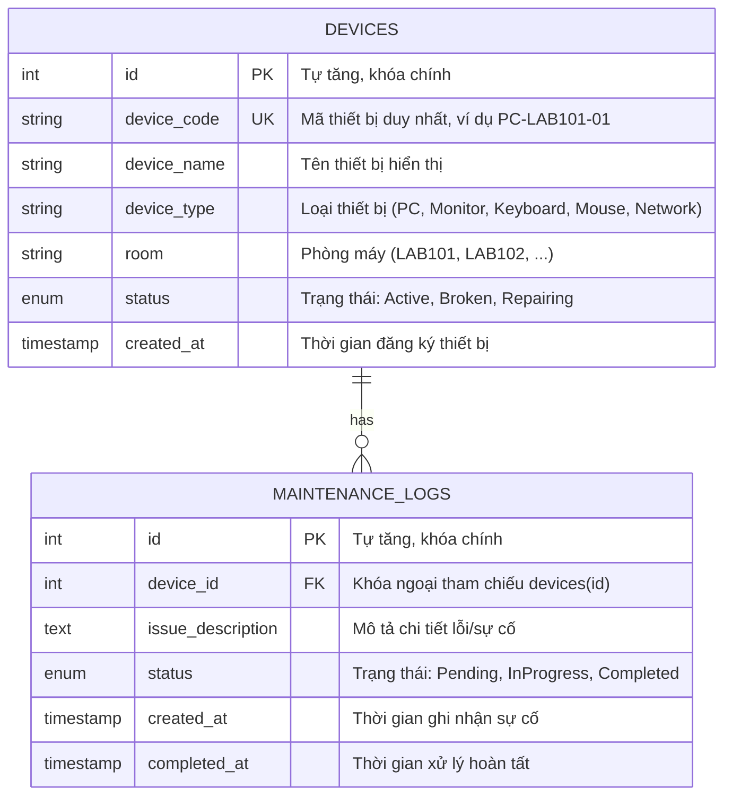

# 🗄️ Thiết Kế Cơ Sở Dữ Liệu (Database Design)

- **Hệ quản trị CSDL:** MariaDB 10.4+ (tương thích MySQL 8.0+)
- **Tên Database:** `lab_management`
- **Bộ mã ký tự (Charset):** `utf8mb4`
- **Đối chiếu ký tự (Collation):** `utf8mb4_unicode_ci`

---

## 1. Sơ đồ Quan hệ Thực thể (Entity-Relationship Diagram)



---

## 2. Chi tiết Cấu trúc Bảng

### 2.1. Bảng `devices` (Quản lý thiết bị phòng máy)

| Tên cột | Kiểu dữ liệu | Thuộc tính / Ràng buộc | Giá trị mặc định | Giải thích ý nghĩa |
|---|---|---|---|---|
| `id` | `INT` | `PRIMARY KEY`, `AUTO_INCREMENT` | Tự tăng | Khóa chính định danh thiết bị |
| `device_code` | `VARCHAR(50)` | `NOT NULL`, `UNIQUE` | | Mã quản lý phần cứng (Duy nhất) |
| `device_name` | `VARCHAR(100)` | `NOT NULL` | | Tên hoặc model thiết bị |
| `device_type` | `VARCHAR(50)` | `NOT NULL` | | Chủng loại (`PC`, `Monitor`, `Keyboard`, `Mouse`, `Network`) |
| `room` | `VARCHAR(50)` | `NOT NULL` | | Phòng máy đặt thiết bị (`LAB101`, `LAB102`) |
| `status` | `ENUM('Active', 'Broken', 'Repairing')` | `NOT NULL` | `'Active'` | Tình trạng hoạt động |
| `created_at` | `TIMESTAMP` | `NOT NULL` | `CURRENT_TIMESTAMP` | Thời điểm tạo thiết bị |

**Chỉ mục (Indexes):**
- `PRIMARY KEY (id)`
- `UNIQUE KEY (device_code)`
- `INDEX idx_devices_room (room)` — Tăng tốc tìm kiếm theo phòng máy
- `INDEX idx_devices_status (status)` — Tăng tốc lọc theo tình trạng
- `INDEX idx_devices_type (device_type)` — Tăng tốc lọc theo loại thiết bị

---

### 2.2. Bảng `maintenance_logs` (Lịch sử sự cố & bảo trì)

| Tên cột | Kiểu dữ liệu | Thuộc tính / Ràng buộc | Giá trị mặc định | Giải thích ý nghĩa |
|---|---|---|---|---|
| `id` | `INT` | `PRIMARY KEY`, `AUTO_INCREMENT` | Tự tăng | Khóa chính bản ghi bảo trì |
| `device_id` | `INT` | `NOT NULL`, `FOREIGN KEY` | | Tham chiếu đến `devices(id)` |
| `issue_description` | `TEXT` | `NOT NULL` | | Mô tả hiện tượng hỏng hóc, sự cố |
| `status` | `ENUM('Pending', 'InProgress', 'Completed')` | `NOT NULL` | `'Pending'` | Trạng thái xử lý bảo trì |
| `created_at` | `TIMESTAMP` | `NOT NULL` | `CURRENT_TIMESTAMP` | Thời điểm ghi nhận sự cố |
| `completed_at` | `TIMESTAMP` | `NULL` | `NULL` | Thời điểm hoàn tất bảo trì |

**Ràng buộc toàn vẹn dữ liệu (Foreign Key Constraints):**
```sql
CONSTRAINT fk_maintenance_device
    FOREIGN KEY (device_id)
    REFERENCES devices (id)
    ON DELETE CASCADE
    ON UPDATE CASCADE
```
*Ghi chú:* Khi một thiết bị bị xóa khỏi hệ thống, toàn bộ lịch sử bảo trì liên quan đến thiết bị đó sẽ tự động được xóa an toàn (`CASCADE`).

**Chỉ mục (Indexes):**
- `PRIMARY KEY (id)`
- `INDEX idx_maintenance_device (device_id)` — Tăng tốc JOIN với bảng thiết bị
- `INDEX idx_maintenance_status (status)` — Tăng tốc lọc các sự cố đang chờ xử lý

---

## 3. Chính sách Bảo mật CSDL (Database Security Guidelines)

1. **Tuyệt đối không dùng tài khoản `root`:**
   Mọi kết nối từ ứng dụng C++ chỉ được phép sử dụng user giới hạn quyền `lab_user`.
2. **Nguyên tắc phân quyền tối thiểu (Least Privilege):**
   User `lab_user` chỉ được cấp 4 quyền thao tác dữ liệu: `SELECT`, `INSERT`, `UPDATE`, `DELETE` trên schema `lab_management`. Không cấp quyền `DROP`, `ALTER`, `GRANT` hay quyền quản trị máy chủ.
3. **Phòng chống tấn công SQL Injection:**
   Toàn bộ mã nguồn C++ truy vấn dữ liệu (`src/database.cpp`) bắt buộc phải sử dụng **Prepared Statements** của MariaDB Connector/C (`MYSQL_STMT`, `mysql_stmt_prepare`, `mysql_stmt_bind_param`). Không sử dụng phép nối chuỗi raw SQL cho các tham số từ client.
4. **Không lưu trữ mật khẩu trong kho mã nguồn:**
   Thông tin đăng nhập chỉ được cấu hình qua biến môi trường hoặc tệp `.env` cục bộ (đã được khai báo trong `.gitignore`).
