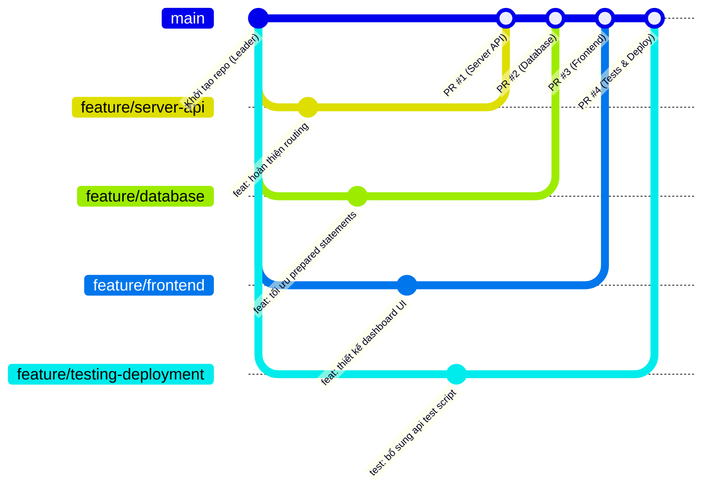

# 🐙 Quy Trình Làm Việc Nhóm Trên GitHub (GitHub Team Workflow)

Tài liệu này quy định chuẩn mực cộng tác Git/GitHub cho nhóm dự án 4 thành viên phát triển hệ thống **Lab Management Server**.

---

## 1. Phân chia Vai trò & Nhánh làm việc

| Thành viên | Trách nhiệm chính | Nhánh Feature phụ trách |
|---|---|---|
| **Leader** (`tit-coder`) | Quản trị Repository, Review PR, phát hành phiên bản | Quản lý `main` |
| **Thành viên 1** | C++ Web Server, cpp-httplib, routing, RESTful API, Makefile | `feature/server-api` |
| **Thành viên 2** | MariaDB, schema.sql, database.h, database.cpp, CRUD | `feature/database` |
| **Thành viên 3** | Frontend: HTML, CSS, JavaScript, Dashboard UI | `feature/frontend` |
| **Thành viên 4** | Kiểm thử API, test script, systemd service, tài liệu triển khai | `feature/testing-deployment` |

---

## 2. Chiến lược Quản lý Nhánh (Branching Strategy)



### Quy tắc bất di bất dịch:
1. **Nhánh `main` là nhánh nguồn chân lý (Source of Truth):**
   - Chỉ chứa code ổn định, đã kiểm thử và được Team Leader phê duyệt.
   - **Nghiêm cấm** push code trực tiếp lên `main` (`git push origin main` bị chặn).
2. **Các thành viên chỉ làm việc trên nhánh Feature được phân công:**
   - Không can thiệp hoặc ghi đè code trên nhánh của thành viên khác trừ khi có thỏa thuận.
3. **Mọi thay đổi đưa vào `main` đều phải thông qua Pull Request (PR).**

---

## 3. Hướng dẫn Từng bước cho Thành viên Nhóm

### Bước 1: Clone Repository về máy Ubuntu
```bash
git clone https://github.com/tit-coder/lab-management-server.git
cd lab-management-server
```

### Bước 2: Chuyển sang nhánh Feature được phân công
```bash
# Ví dụ thành viên làm Frontend:
git checkout feature/frontend

# Kiểm tra nhánh hiện tại
git branch
```

### Bước 3: Đồng bộ mã nguồn mới nhất từ `main` trước khi code
```bash
git checkout main
git pull origin main
git checkout feature/frontend
git merge main
```

### Bước 4: Viết code và Commit theo chuẩn Conventional Commits
Quy ước đặt thông điệp commit:
- `feat: <mô tả>` — Tính năng mới
- `fix: <mô tả>` — Sửa lỗi
- `docs: <mô tả>` — Cập nhật tài liệu
- `refactor: <mô tả>` — Tái cấu trúc mã nguồn không đổi chức năng
- `test: <mô tả>` — Thêm hoặc sửa kịch bản kiểm thử

```bash
git add .
git commit -m "feat: bổ sung bảng dữ liệu thiết bị và modal báo hỏng"
```

### Bước 5: Đẩy nhánh lên GitHub Remote
```bash
git push origin feature/frontend
```

---

## 4. Quy trình Tạo và Phê duyệt Pull Request (PR)

1. **Tạo PR trên giao diện GitHub:**
   - Truy cập: `https://github.com/tit-coder/lab-management-server/pulls`
   - Bấm **New pull request**.
   - Chọn Base: `main` ⬅ Compare: `feature/<tên-nhánh>`.
   - Điền đầy đủ thông tin theo mẫu `.github/pull_request_template.md`.
2. **Tự kiểm tra (Self-check):**
   - Đảm bảo mã nguồn biên dịch thành công (`make`).
   - Đảm bảo không commit file nhạy cảm (`.env`, binary `bin/`, object `build/`).
3. **Review & Phê duyệt:**
   - Team Leader hoặc ít nhất 1 thành viên khác kiểm tra mã nguồn (Code Review).
   - Nếu có nhận xét (Comment), thành viên commit bổ sung lên nhánh feature đó, GitHub PR sẽ tự động cập nhật.
4. **Merge vào `main`:**
   - Sau khi được Leader Approve, tiến hành **Squash and merge** hoặc **Merge pull request** để lưu lại lịch sử rõ ràng.

---

## 5. Xử lý Xung đột Mã nguồn (Merge Conflicts)

Nếu nhánh của bạn bị conflict với `main`, thực hiện xử lý cục bộ:
```bash
git checkout feature/<tên-nhánh>
git fetch origin
git merge origin/main

# Trình soạn thảo sẽ đánh dấu các đoạn xung đột:
# <<<<<<< HEAD (code của bạn)
# =======
# >>>>>>> origin/main (code từ main)

# Mở VS Code / trình soạn thảo để chọn đoạn code đúng.
# Sau khi sửa xong:
git add <các-file-xung-đột>
git commit -m "fix: giải quyết merge conflict với nhánh main"
git push origin feature/<tên-nhánh>
```
PR trên GitHub sẽ tự động chuyển sang trạng thái sẵn sàng merge.
