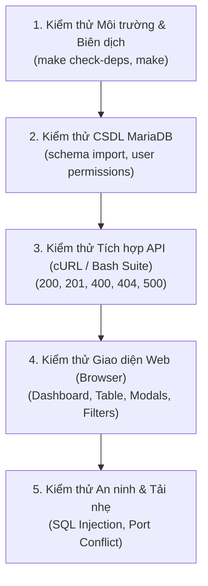

# 🧪 Kế Hoạch & Ma Trận Kiểm Thử Hệ Thống (Test Plan)

- **Dự án:** Lab Management Server — Quản lý Thiết bị Phòng máy
- **Phạm vi kiểm thử:** Backend C++, MariaDB Integration, RESTful API Endpoints, Giao diện Web Client.

---

## 1. Mục tiêu Kiểm thử
1. Đảm bảo toàn bộ mã nguồn C++ biên dịch thành công không có cảnh báo/lỗi nghiêm trọng trên Ubuntu Linux.
2. Kiểm chứng độ tin cậy và tính đúng đắn của 10 RESTful API endpoints.
3. Đảm bảo an toàn CSDL bằng việc xác nhận cơ chế Prepared Statements chống tấn công SQL Injection.
4. Kiểm tra giao diện người dùng hoạt động trơn tru: tìm kiếm, lọc dữ liệu, hiển thị badge và xử lý sự cố.

---

## 2. Các Cấp độ Kiểm thử (Test Levels)

---

## 3. Ma trận Kịch bản Kiểm thử Chi tiết (Test Cases Matrix)

| Mã Test Case | Hạng mục kiểm thử | Dữ liệu đầu vào (Input) | Kết quả mong đợi (Expected Output) | Mã HTTP |
|---|---|---|---|---|
| **TC-01** | Health Check | `GET /api/health` | Trả về JSON trạng thái server và `"database": true` | `200 OK` |
| **TC-02** | Thống kê Dashboard | `GET /api/stats` | JSON chứa tổng thiết bị và số lượng theo từng trạng thái | `200 OK` |
| **TC-03** | Lấy toàn bộ thiết bị | `GET /api/devices` | Danh sách mảng thiết bị đầy đủ các trường | `200 OK` |
| **TC-04** | Tìm kiếm thiết bị | `GET /api/devices?room=LAB101&search=Dell` | Chỉ trả về thiết bị tại phòng LAB101 có chứa chữ Dell | `200 OK` |
| **TC-05** | Tạo thiết bị hợp lệ | `POST /api/devices` kèm JSON hợp lệ | Tạo thành công, trả về id mới và dữ liệu thiết bị | `201 Created` |
| **TC-06** | Tạo thiếu trường | `POST /api/devices` thiếu `device_name` | Trả về lỗi báo thiếu trường bắt buộc | `400 Bad Request` |
| **TC-07** | Tạo trùng mã | `POST /api/devices` trùng `device_code` đã có | Báo lỗi trùng lặp khóa duy nhất (Duplicate entry) | `400 Bad Request` |
| **TC-08** | Lấy thiết bị theo ID | `GET /api/devices/1` | Trả về đúng thông tin thiết bị có ID 1 | `200 OK` |
| **TC-09** | Lấy ID không tồn tại | `GET /api/devices/99999` | Báo không tìm thấy thiết bị (`Device not found`) | `404 Not Found` |
| **TC-10** | Cập nhật thiết bị | `PUT /api/devices/1` kèm tên/trạng thái mới | Dữ liệu được cập nhật thành công trong MariaDB | `200 OK` |
| **TC-11** | Xóa thiết bị | `DELETE /api/devices/12` | Xóa thành công, các log bảo trì liên quan bị xóa | `200 OK` |
| **TC-12** | Tạo phiếu bảo trì | `POST /api/maintenance` với device_id hợp lệ | Bản ghi sự cố được tạo với trạng thái Pending | `201 Created` |
| **TC-13** | Hoàn thành bảo trì | `PUT /api/maintenance/1` với status Completed | Trạng thái chuyển thành Completed, completed_at được cập nhật | `200 OK` |
| **TC-14** | Phòng chống SQLi | Gửi input chứa chuỗi `' OR '1'='1` | Hệ thống xử lý an toàn qua Prepared Statements, không bị lỗi | `200/400` an toàn |

---

## 4. Tiêu chí Nghiệm thu (Acceptance Criteria)

- **Đạt chuẩn Biên dịch:** Lệnh `make` thực thi sạch sẽ trên Ubuntu, nhị phân sinh ra tại `bin/server`.
- **Tỷ lệ Pass API:** Toàn bộ các kịch bản kiểm thử trong `tests/run_api_tests.sh` đạt 100% PASS.
- **Tính Bền vững Dữ liệu:** Khởi động lại server không làm mất dữ liệu đã lưu trong MariaDB.
- **Tiêu chuẩn Giao diện:** Giao diện phản hồi không có lỗi JavaScript console khi thao tác các tính năng chính.
